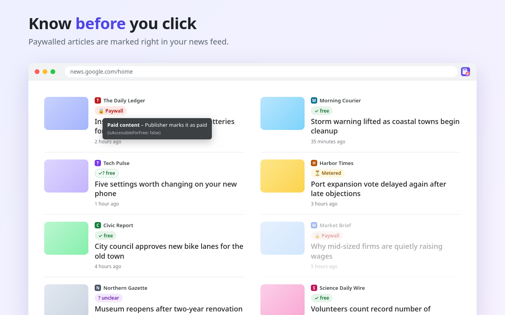
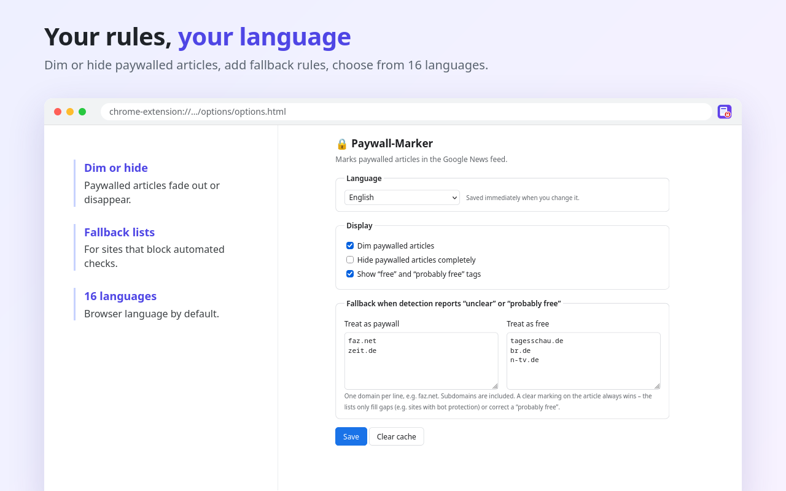

<p align="center">
  
</p>

<h1 align="center">Paywall-Marker</h1>

<p align="center">
  <strong>Know before you click.</strong><br>
  A Chrome extension that marks paywalled articles right in your Google News feed.
</p>

<p align="center">
  <a href="https://verothsan.github.io/paywall-marker/">Website</a> ·
  <a href="https://verothsan.github.io/paywall-marker/privacy.html">Privacy policy</a> ·
  <a href="https://github.com/VerothSan/paywall-marker/issues">Feedback</a>
</p>



## Why

You open an interesting headline in Google News, and the article turns out to be behind a paywall. Paywall-Marker shows you **before** you click whether an article is free to read, so you don't waste clicks on content you can't access.

## Tags

| Tag | Meaning |
|---|---|
| 🔒 **Paywall** | The publisher marks the article as paid content (fully or partly). |
| ⏳ **Metered** | A few articles are free, then a subscription is required. |
| ✓ **free** | The publisher explicitly marks the article as free. |
| ✓? **free** | The page is marked up as an article but carries no paywall marking, so it is *probably* free. Shown with a dashed border. |
| ? **unclear** | The site blocks automated checks, requires cookie consent first, or has no markup at all. |

Hover over a tag to see the reason, e.g. *“Paid content – Publisher marks it as paid (isAccessibleForFree: false)”*.

## How it works

1. **Find the real link.** Google News links are encoded. The extension reads the publisher URL that Google embeds in each feed item. If that is missing, it resolves the link via Google News itself.
2. **Fetch the article.** For articles currently visible on screen (or about to be), the background worker fetches the publisher page. At most 4 requests run in parallel.
3. **Read the publisher's own marking**, in this order:
   - schema.org `isAccessibleForFree` in the page's JSON-LD. Google asks publishers with paywalls to provide this, which makes it the most reliable signal.
   - `<meta property="article:content_tier">` (`locked`, `metered`, `free`)
   - known URL patterns of paywalled sections
   - article markup without any paywall marking → *probably free*
4. **Cache the result** locally: 7 days for clear results, 2 hours for unclear ones.

Nothing is bypassed or unlocked. Paywall-Marker only reads what publishers state about their own articles.

## Features

- Dim (default) or completely hide paywalled articles
- **Fallback lists** for domains: decide yourself how sites that block automated checks, or that publish no marking, should be treated. A clear marking on the article always wins over your lists.
- **16 languages** for tags, tooltips and settings: English, Deutsch, Español, Français, Português, Українська, 日本語, Norsk, Svenska, Suomi, Dansk, Italiano, Nederlands, Polski, Čeština, Hrvatski. The browser language is the default and can be changed in the settings.
- Light and dark mode



## Installation

### From the Chrome Web Store

*Coming soon.*

### Manually (developer mode)

1. Download or clone this repository.
2. Open `chrome://extensions` and turn on **Developer mode** (top right).
3. Click **Load unpacked** and select the repository folder (the one containing `manifest.json`).
4. Open or reload [Google News](https://news.google.com/).

Click the toolbar icon to open the settings.

## Privacy

- No tracking, no analytics, no ads, no server of our own
- Settings and check results are stored only in your browser
- Article pages are fetched directly from the publisher by your browser, including the cookies you already have for that site (e.g. a cookie consent). This lets checks succeed on sites that require consent.

Full details: [privacy policy](https://verothsan.github.io/paywall-marker/privacy.html) (available in all 16 languages).

## Limitations

- **Bot protection:** some publishers block automated requests. Visiting the site once normally (and accepting cookies) often fixes this. Otherwise use the fallback lists.
- **“Probably free”** is an inference from missing data: a publisher that has a paywall but publishes no marking at all would be shown as probably free. Add such domains to your paywall fallback list.
- **Layout changes:** if Google changes the structure of the News feed, link detection may need an update.
- Works on `news.google.com` in Chrome and other Chromium-based browsers. The Google News mobile app is not supported.

## Project structure

```
manifest.json        Extension manifest (Manifest V3)
_locales/            Name and description in 16 languages (used by Chrome and the Web Store)
src/
  content.js         Runs on news.google.com: finds articles, inserts tags
  content.css        Tag styles (light and dark)
  background.js      Service worker: fetches pages, queue, cache, fallback lists
  detect.js          Paywall detection from HTML (no Chrome APIs, testable with Node)
  i18n.js            UI translations (tags, tooltips, settings)
  settings.js        Default settings
options/             Settings page
icons/               Extension icons (PNG + SVG sources)
docs/                Website and privacy policy (GitHub Pages)
store/               Web Store tooling: build script, image template, listing texts
LICENSE.md           PolyForm Noncommercial License 1.0.0
```

## Building a release

```bash
store/build.sh
```

This creates `dist/paywall-marker-<version>.zip` (only the files the extension needs at runtime) and the Web Store images in `dist/store/`. It requires `python3`, `firefox`, ImageMagick and `zip`.

The privacy policy is generated from `store/privacy.py`:

```bash
python3 store/privacy.py
```

## License

Copyright © 2026 VerothSan. Licensed under the [PolyForm Noncommercial License 1.0.0](../LICENSE.md).

In plain words (the [license text](../LICENSE.md) is what counts):

- ✅ Use it for any **noncommercial** purpose: personal use, hobby projects, study, research, charities, schools, public institutions
- ✅ **Modify** the source code and build your own version
- ✅ **Share** copies, modified or not, for noncommercial purposes, as long as you include the license and the `Required Notice` line
- ❌ Use it for **commercial** purposes (e.g. selling it, bundling it into a paid product, using it in a business)

This makes Paywall-Marker *source-available*, not “open source” in the [OSI sense](https://opensource.org/osd), because open-source licenses allow commercial use. For a commercial license, please [open an issue](https://github.com/VerothSan/paywall-marker/issues).

## Feedback

Found an article that is marked incorrectly? Please [open an issue](https://github.com/VerothSan/paywall-marker/issues) with the article URL and the tooltip text of its tag.

---

<sub>© 2026 VerothSan · PolyForm Noncommercial 1.0.0 · Not affiliated with Google. Google News is a trademark of Google LLC.</sub>
